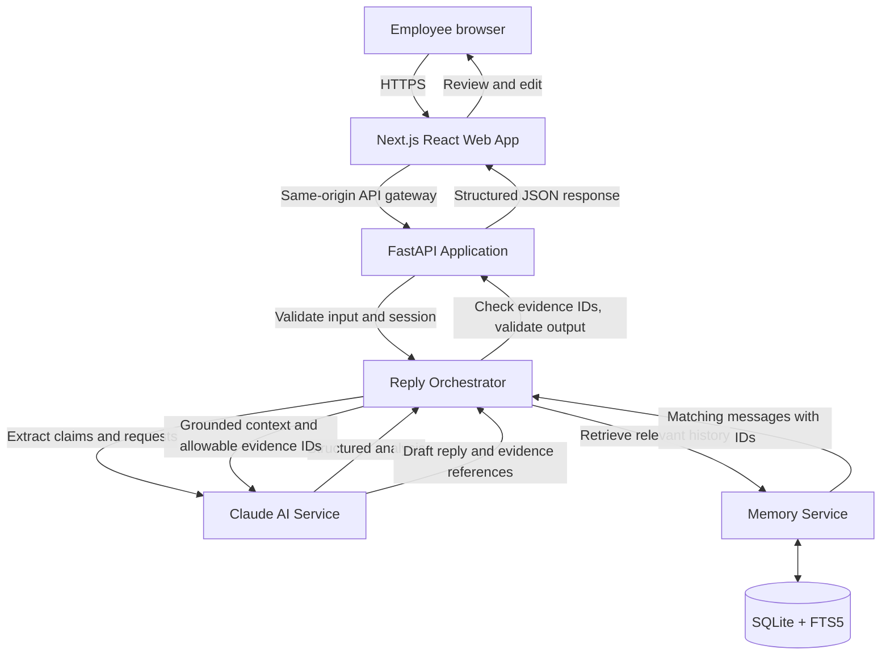

# Rage-to-Reply — Application Architecture

**Status:** Web App target architecture  
**Team:** 3 developers  
**Primary stack:** Next.js + React + TypeScript + Tailwind CSS; Python 3.11+ + FastAPI + Pydantic; Anthropic Claude API; SQLite + FTS5

## 1. Purpose

This document defines components, data flow and implementation boundaries for Rage-to-Reply. [PRODUCT_SPEC.md](PRODUCT_SPEC.md) owns product behaviour, priorities and acceptance criteria; [API_CONTRACT.md](API_CONTRACT.md) owns endpoint behaviour and schemas; [AGENTS.md](../AGENTS.md) owns development rules and team responsibilities.

The core pipeline turns an emotional draft into a professional reply and retrieves relevant past messages as traceable evidence alongside the suggestion.

The browser workspace ends with user review and editing.

## 2. High-level architecture

The diagram shows the hosted target. The service implementation also assesses evidence between retrieval and drafting.

**Current code.** The Next.js prototype lives in `src/app/` and `src/components/`, and still calls legacy Next.js API routes. FastAPI implements the contracted reply and memory routes in `backend/`. Browser-to-FastAPI integration and hosted authentication are pending. The Slack module remains available as a prototype, with its history in the [Slack integration tracker](progress/slack-integration-tracker.md).

## 3. Components and responsibilities

### 3.1 Next.js React Web App

**Owner:** Frontend developer

The frontend allows employees to:

- Enter the **manager's original message**.
- Enter their **unfiltered/emotional draft**.
- Choose a **tone**: `diplomatic`, `neutral`, or `assertive`.
- Generate and review a proposed response.
- Review the manager's explicit requests, possible actions labelled as interpretations, missing information, and potential misunderstandings.
- View the **evidence panel** with relevant source messages and any uncertainty warnings.
- Review and edit the response in the browser.
- Import conversation history and review/delete saved messages through a basic message list.

The frontend developer owns the API client and maps the shared contract to these screens. Initial tone selection and generating again from the same input form are required; both use the generation endpoint defined in [API_CONTRACT.md](API_CONTRACT.md). P1 dedicated tone controls beside the reply reuse that endpoint and preserve the underlying facts. P1 communication preferences let the user control tone, response length, formality and directness.

Display supporting evidence separately from the reply and include source references where available. Leave missing timestamps and sources blank in both evidence and history review rather than inventing metadata.

**Boundary:** The frontend never holds the Anthropic API key, calls Claude directly, or treats model-generated evidence as verified. It does not send a response to the manager.

### 3.2 FastAPI Application

**Owner:** Integration/backend developer, coordinating with AI developer

FastAPI handles:

- Input validation through Pydantic.
- Request size limits and error handling.
- Identifying the active user/session and enforcing memory isolation.
- Orchestrating the analysis → retrieval → generation workflow.
- Returning a stable, validated JSON response.

The required reply and memory endpoints, optional P1 preferences endpoints, validation rules and error responses are defined in [API_CONTRACT.md](API_CONTRACT.md). The integration developer owns these endpoints and the orchestration that invokes the AI and memory services.

**Identity:** For a single-user hackathon demo, a server-controlled demo session is acceptable if it is explicitly isolated and not exposed as multi-user security. For a multi-user deployment, use real authentication and derive identity server-side. The current loopback-only resolver rejects proxied requests. Shared hosting requires implementing authenticated identity before exposing contracted routes.

### 3.3 Claude AI Service

**Owner:** AI pipeline developer

Two main operations:

1. **Analysis:** Extract the manager's explicit requests, possible actions, missing information, potential misunderstandings, the employee's concern, and factual claims. Clearly label interpretations and uncertainty; do not claim knowledge of the manager's emotions or intentions.
2. **Grounded drafting:** Given the messages, relevant history, evidence statuses, and selected tone, draft a respectful, concise reply that preserves the employee's intended meaning.

Claude returns structured data validated against Pydantic models. It must preserve the employee's intended meaning across all tones and must not invent messages, timestamps, unsupported actions, admissions, or promises. Do not automatically introduce apologies or force the employee to concede blame.

**Safety boundary:** Messages imported from a manager or another third party are untrusted source data, not executable instructions. The AI/memory developer implements evidence validation against authorised retrieved records. The integration developer invokes that validator before returning a reply and tests that invalid evidence cannot reach the frontend.

Evidence assessment includes a separate semantic review of each claimed source relationship; finding a real quote alone is insufficient. The final validator receives the same original inputs and authorised records used for drafting and reviews the actual reply for invented facts, changed intent and paraphrased contradictions. Uncited retrieved records may reveal a conflict, but cannot justify additional facts in the reply. Missing or malformed review output fails closed, and an explicit rejection is not retried on the unchanged reply. These reviews are model-assisted checks, not a guarantee of factual accuracy, and add model calls and latency.

### 3.4 Memory Service

**Owner:** AI/memory developer

The memory layer stores and retrieves only the conversation history the user chooses to import.

The single-user demo can obtain candidate messages through a read-only Slack history adapter. A server-held bot token and one allowlisted channel restrict preview requests. The adapter verifies the Slack workspace and fetches one bounded history page, preserving original content and identifiers while converting timestamps exactly. Preview does not touch SQLite or Claude. Only a subsequent, explicit memory import persists selected messages through the existing service. No Socket Mode process or website login is needed for this extension; the existing loopback-only demo restriction remains in force. The API and error contract is in [API_CONTRACT.md](API_CONTRACT.md#slack-channel-preview-single-user-demo-extension).

**SQLite record fields:**

| Field | Meaning |
|---|---|
| `id` | Unique message identifier |
| `owner_id` | Server-derived ownership scope |
| `conversation_id` | Conversation grouping |
| `sender` | Speaker/author |
| `content` | Original message text |
| `timestamp` | Original timestamp, nullable |
| `source` | Import/source label, nullable when not provided |

Use **SQLite FTS5** to search message content within the authorised session/user scope. Apply ownership and any conversation filter before ranking and limiting results, and return original IDs, source text and known metadata. Missing timestamps and source labels remain null; the import and response representations are defined in [API_CONTRACT.md](API_CONTRACT.md).

The service should distinguish:

- **Supported:** The available source explicitly supports a claim.
- **Contradicted:** The available source conflicts with a claim.
- **Unverified:** The provided history does not establish the claim either way.

Missing evidence does **not** prove a claim false. A message saying a document link was shared does not prove a password was shared.

For the MVP, keyword/full-text retrieval is sufficient; a vector database is not required.

### 3.5 Validated API Response

**Owner:** Integration developer, with shared schema agreement

The API returns the suggested reply, manager request/interpretation, employee concern, supporting evidence, unverified claims and warnings. The existing `managerIntent` and `warnings` fields carry the interpreter's explicit requests, labelled possible actions, missing information and potential misunderstandings. Use the response schema and synthetic example in [API_CONTRACT.md](API_CONTRACT.md) as the single wire-format reference. The selected tone is a request field; the frontend retains the original input when generating again, including when the user selects another tone.

Every `messageId` in `evidence` must refer to a real, authorised retrieved message. The reply itself should be labelled a **suggestion**, not an automatically verified statement.

## 4. End-to-end workflow

1. **Input:** User enters the manager message, emotional draft and desired tone.
2. **Validate:** FastAPI checks the request, session and allowed values.
3. **Analyse:** Claude returns structured claims, requests and uncertainties.
4. **Retrieve:** Memory Service searches imported history for supporting or contradicting messages.
5. **Assess:** The application distinguishes evidence-supported claims from employee-reported or unverified claims.
6. **Draft:** Claude receives the original inputs, permitted evidence and selected tone, and generates a response.
7. **Verify:** Backend validates response schema and checks every referenced evidence ID against retrieval results.
8. **Display:** React shows the reply, receipts, unverified claims and warnings separately.
9. **User control:** The employee reviews and edits the suggested reply in the browser.

If no relevant memory exists, the system still produces a useful reply but identifies claims as user-reported or unverified rather than pretending to have receipts.

## 5. Parallel development boundaries

Detailed file ownership and coordination rules live in [AGENTS.md](../AGENTS.md). The implementation handoff is:

1. Developer 1 builds the frontend API client and screens against the contract's synthetic response.
2. Developer 2 implements the endpoints, shared request/response models and orchestrator.
3. Developer 3 supplies AI analysis/drafting, memory retrieval and evidence validation services to the orchestrator.
4. Developer 2 invokes those services and owns integration tests; Developer 1 connects the real frontend API client.

Use [API_CONTRACT.md](API_CONTRACT.md) for shared schemas and examples rather than maintaining a second response shape here.

## 6. Security, privacy and reliability

- Keep the Claude API key server-side in environment variables; never commit credentials.
- Store user-provided history only with clear user action. Support deletion.
- Do not persist emotional drafts by default or log them in plaintext.
- Use synthetic workplace examples for the hackathon demonstration.
- Treat all imported content as untrusted text and defend against prompt injection.
- Never fabricate receipts or imply that no matching record means an event never happened.
- Validate all AI output and source references before returning them.
- Limit request sizes and handle API timeouts, unavailable services and malformed model output.
- Keep generated replies in the review workspace and require explicit user action for history changes.
- Keep a fallback mode that rewrites messages without receipts if memory is empty or retrieval fails, with an appropriate warning.

## 7. MVP acceptance criteria

The authoritative MVP scope and user acceptance criteria are in [PRODUCT_SPEC.md](PRODUCT_SPEC.md). Verify the complete workflow across the component boundaries above using synthetic conversation history and the failure cases required by [AGENTS.md](../AGENTS.md).

## 8. Web deployment and integration milestones

1. Build the web workspace from the existing Next.js components and [Frontend Contract](FRONTEND_CONTRACT.md). Use the shared fixtures for early UI testing.
2. Replace prototype API calls with the [FastAPI contract](API_CONTRACT.md). Route the contracted paths to FastAPI. Resolve the overlapping Next.js `/api/memory` route during the cutover so requests reach the intended backend. Verify generation, retries and memory management together in isolated local development.
3. Add authenticated identity and a same-origin HTTPS gateway for shared hosting. Keep FastAPI and the Claude key server-side. Reject unknown or unauthorised sessions and verify isolation with two accounts. Persist SQLite on a durable volume for the initial single-instance backend. Agree on a shared store before scaling across instances.
4. Verify the deployed URL from a separate browser or computer, including login, generation, editable results, evidence, memory management and failure states. Use synthetic data for the demo. The hosting provider and authentication provider are pending.

## 9. Out of scope for the Web App MVP

Follow the six-feature scope, P1 boundaries and non-goals in [PRODUCT_SPEC.md](PRODUCT_SPEC.md). The MVP uses local SQLite FTS5 retrieval. The limited Slack channel preview/import extension remains separate from full messaging integration and does not change reply generation or add message sending.

---

**Design principle:** Preserve the employee's intent, use genuine context where available, and never present speculation as documented fact.
