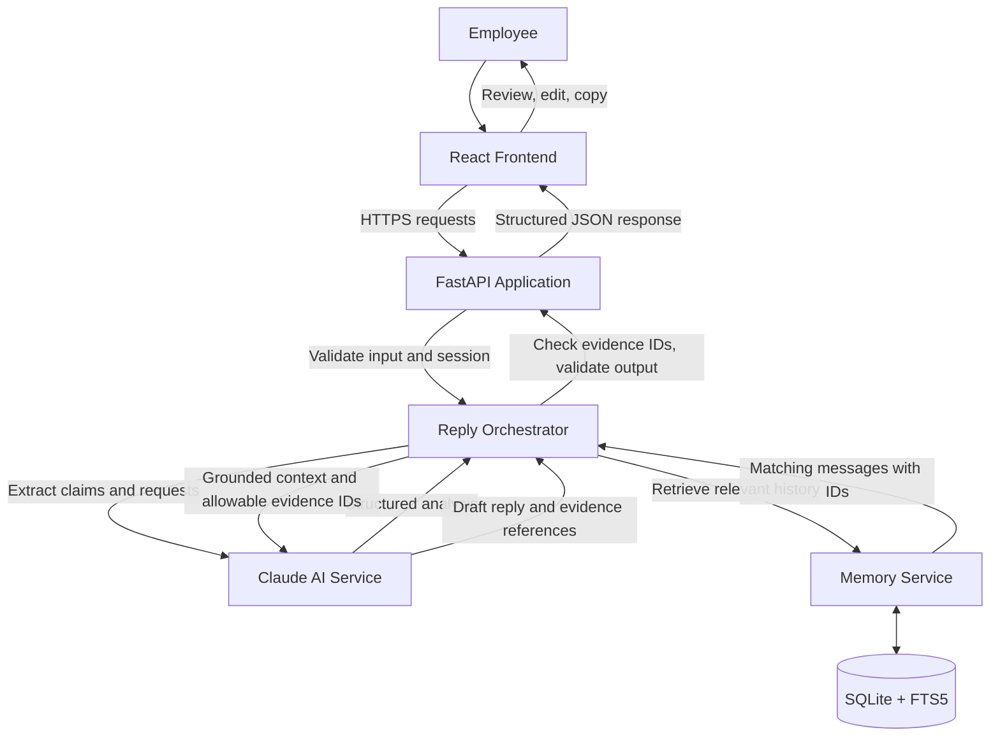

# Rage-to-Reply — Application Architecture

**Status:** Hackathon MVP architecture  
**Team:** 3 developers  
**Primary stack:** React + TypeScript, FastAPI + Python, Anthropic Claude API, SQLite + FTS5

## 1. Purpose

Rage-to-Reply helps employees turn an emotional draft into a professional, accurate reply to a workplace message. Its differentiator, **Replies with Receipts**, retrieves relevant past messages and presents traceable evidence alongside the proposed reply.

The user reviews and copies the response; **the application never sends it automatically**.

## 2. High-level architecture



The Claude AI Service appears twice in the logical flow: once to extract relevant claims and once to generate a reply using retrieved context. It may be implemented as one service with separate methods.

## 3. Components and responsibilities

### 3.1 React Frontend

**Owner:** Frontend developer

The frontend allows employees to:

- Enter the **manager's original message**.
- Enter their **unfiltered/emotional draft**.
- Choose a **tone**: `diplomatic`, `neutral`, or `assertive`.
- Generate and review a proposed response.
- View the **evidence panel** with relevant source messages and any uncertainty warnings.
- Edit the response and copy it manually.
- Import conversation history and view/delete saved messages (MVP as time allows).

**Boundary:** The frontend never holds the Anthropic API key, calls Claude directly, or treats model-generated evidence as verified. It does not send a response to the manager.

### 3.2 FastAPI Application

**Owner:** Integration/backend developer, coordinating with AI developer

FastAPI handles:

- Input validation through Pydantic.
- Request size limits and error handling.
- Identifying the active user/session and enforcing memory isolation.
- Orchestrating the analysis → retrieval → generation workflow.
- Returning a stable, validated JSON response.

**MVP endpoints:**

| Method | Route | Purpose |
|---|---|---|
| `POST` | `/api/reply/generate` | Run the grounded reply pipeline |
| `POST` | `/api/memory/import` | Import user-provided conversation history |
| `GET` | `/api/memory/search` | Return relevant stored messages for review |
| `DELETE` | `/api/memory` | Delete the active user's imported history |
| `GET` | `/api/preferences` | Read communication preferences (optional) |
| `PUT` | `/api/preferences` | Update communication preferences (optional) |

**Identity:** For a single-user hackathon demo, a server-controlled demo session is acceptable if it is explicitly isolated and not exposed as multi-user security. For a multi-user deployment, use real authentication and derive identity server-side; never trust a client-supplied `userId` as proof of access.

### 3.3 Claude AI Service

**Owner:** AI pipeline developer

Two main operations:

1. **Analysis:** Extract the manager's explicit request, the employee's concern, factual claims, clarification requests, and uncertainties. Treat interpretations of intent as hypotheses, not facts.
2. **Grounded drafting:** Given the messages, relevant history, evidence statuses, and selected tone, draft a respectful, concise reply that preserves the employee's intended meaning.

Claude returns structured data validated against Pydantic models. It must not invent messages, timestamps, unsupported actions, admissions, or promises. Do not automatically introduce apologies or force the employee to concede blame.

**Safety boundary:** Messages imported from a manager or another third party are untrusted source data, not executable instructions. The orchestrator validates any evidence IDs returned by Claude against retrieved database records.

### 3.4 Memory Service

**Owner:** AI/memory developer

The memory layer stores and retrieves only the conversation history the user chooses to import.

**SQLite record fields:**

| Field | Meaning |
|---|---|
| `id` | Unique message identifier |
| `session_id` / `user_id` | Ownership scope |
| `conversation_id` | Conversation grouping |
| `sender` | Speaker/author |
| `content` | Original message text |
| `timestamp` | Original timestamp, nullable |
| `source` | Import/source label |

Use **SQLite FTS5** to search message content, then filter results by the authorised session/user. Rank results for relevance and return the original IDs, source text and known timestamps.

The service should distinguish:

- **Supported:** The available source explicitly supports a claim.
- **Contradicted:** The available source conflicts with a claim.
- **Unverified:** The provided history does not establish the claim either way.

Missing evidence does **not** prove a claim false. A message saying a document link was shared does not prove a password was shared.

For the MVP, keyword/full-text retrieval is sufficient; a vector database is not required.

### 3.5 Validated API Response

**Owner:** Integration developer, with shared schema agreement

The API returns the suggested reply and clearly separated context:

```json
{
  "reply": "Hi, the document link requires a password that I don't currently have. Could you please share it?",
  "tone": "neutral",
  "managerIntent": "The manager is asking why the documents haven't been accessed.",
  "employeeConcern": "The employee cannot access the protected link.",
  "evidence": [
    {
      "messageId": "msg_001",
      "sender": "Manager",
      "timestamp": "2026-11-18T10:30:00+10:00",
      "content": "I've uploaded the documents to the shared drive.",
      "supportedClaim": "The manager shared a document location."
    }
  ],
  "unverifiedClaims": ["Whether a password was provided through another channel."],
  "warnings": [],
  "suggestedActions": ["Confirm the access issue and request the password."]
}
```

Every `messageId` in `evidence` must refer to a real, authorised retrieved message. The reply itself should be labelled a **suggestion**, not an automatically verified statement.

## 4. End-to-end workflow

1. **Input:** User enters the manager message, emotional draft and desired tone.
2. **Validate:** FastAPI checks the request, session and allowed values.
3. **Analyse:** Claude returns structured claims, requests and uncertainties.
4. **Retrieve:** Memory Service searches imported history for supporting or contradicting messages.
5. **Assess:** The application distinguishes evidence-supported claims from employee-reported or unverified claims.
6. **Draft:** Claude receives the original inputs, permitted evidence and selected tone, and generates a response.
7. **Verify:** Backend validates response schema and checks every referenced evidence ID against retrieval results.
8. **Display:** React shows the reply, receipts, uncertainties and suggested next actions.
9. **User control:** Employee edits or copies the message; nothing is sent automatically.

If no relevant memory exists, the system still produces a useful reply but identifies claims as user-reported or unverified rather than pretending to have receipts.

## 5. Parallel development boundaries

| Developer | Main ownership | Independent deliverable |
|---|---|---|
| 1 — Frontend | `frontend/` | Working message, tone, reply and evidence screens against mock API responses |
| 2 — Integration | `backend/api/`, shared contracts, deployment | Stable endpoints, request validation, integration tests and error handling |
| 3 — AI & Memory | `backend/services/`, `backend/memory/` | Claude analysis/drafting, SQLite search and evidence checks |

**Integration contract:** Agree on the `POST /api/reply/generate` request/response shape and a synthetic example response before parallel development begins. Avoid modifying another developer's files without coordinating. Merge small, tested changes regularly.

## 6. Security, privacy and reliability

- Keep the Claude API key server-side in environment variables; never commit credentials.
- Store user-provided history only with clear user action. Support deletion.
- Do not persist emotional drafts by default or log them in plaintext.
- Use synthetic workplace examples for the hackathon demonstration.
- Treat all imported content as untrusted text and defend against prompt injection.
- Never fabricate receipts or imply that no matching record means an event never happened.
- Validate all AI output and source references before returning them.
- Limit request sizes and handle API timeouts, unavailable services and malformed model output.
- Require explicit review and user action to copy/export; do not automatically send workplace replies.
- Keep a fallback mode that rewrites messages without receipts if memory is empty or retrieval fails, with an appropriate warning.

## 7. MVP acceptance criteria

- A user can submit the manager message, emotional draft and tone.
- Claude returns a professional suggestion that preserves the employee's concern.
- A user can import synthetic prior messages and retrieve them later.
- A related historical message appears as a source-linked receipt where supported.
- Unsupported claims are not converted into invented facts.
- The UI displays the generated reply, evidence and warnings separately.
- The user can edit/copy the reply but cannot send it automatically through the app.
- The complete flow works end-to-end using a test dataset without manual backend intervention.

## 8. Out of scope for the 18-hour MVP

Direct Gmail/Slack integrations, voice mode, browser extensions, embeddings/vector databases, enterprise HR features, automatic sending, persistent manager profiling, and advanced sentiment/mental-health inference.

---

**Design principle:** Preserve the employee's intent, use genuine context where available, and never present speculation as documented fact.
